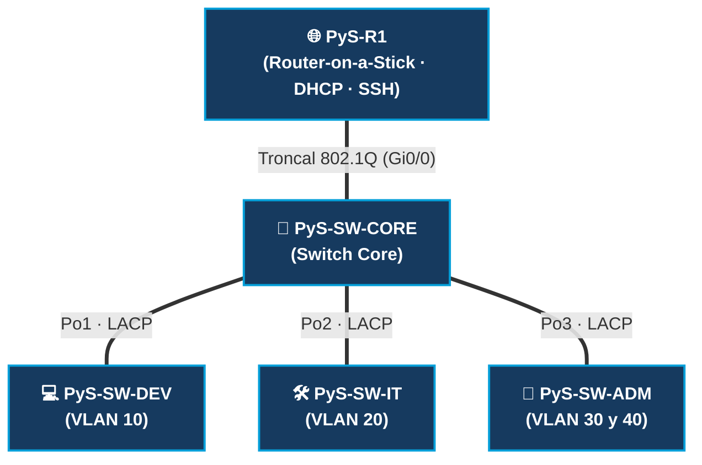

<div align="center">

# 🌐 LAB-01: Diseño de Red Empresarial Segmentada

**PyS Networks — Topología Jerárquica en GNS3 (CCNA 200-301)**


</div>

---

## 🎯 Resumen del Laboratorio

Diseño e implementación de una red empresarial jerárquica de tres niveles (**Router**, **Switch Core** y **3 Switches de Acceso**) para segmentar cuatro departamentos corporativos y una red de gestión, aplicando direccionamiento **VLSM**, agregación de enlaces **LACP**, enrutamiento **Router-on-a-Stick**, **DHCPv4** centralizado y endurecimiento de capa 2.



---

## 🧰 Tecnologías Implementadas

| 🔧 Tecnología | 📋 Implementación en el Laboratorio |
| :--- | :--- |
| 🌐 **IPv4 con VLSM** | Segmentación del bloque `192.168.10.0/24` en 5 subredes (`/26`, `/27`, `/28`, `/29`, `/29`). El bloque `.128/25` queda libre para crecimiento. |
| 🏷️ **VLANs** | Segmentación por departamentos (`10`, `20`, `30`, `40`), gestión (`99`), aislamiento de puertos (`998`) y nativa (`999`). |
| 🌉 **Trunking 802.1Q** | Configurado hacia `PyS-R1` y sobre `Po1`, `Po2` y `Po3`. Permite VLANs `10, 20, 30, 40, 99` con **VLAN nativa `999`**. |
| 🧭 **Router-on-a-Stick** | Enrutamiento Inter-VLAN en `PyS-R1` mediante subinterfaces (`Gi0/0.10`, `.20`, `.30`, `.40`, `.99` y `.999` nativa). |
| 🔗 **EtherChannel (LACP)** | 3 grupos (`Po1`, `Po2`, `Po3`) de 2 enlaces cada uno en modo activo (`channel-group N mode active`) entre `SW-CORE` y switches de acceso. |
| 🖧 **DHCPv4** | `PyS-R1` actúa como servidor DHCP para las 4 VLANs de usuarios (`POOL_DEV`, `POOL_IT`, `POOL_ADM`, `POOL_GER`) con reserva de IPs. |
| 🛡️ **Seguridad de Capa 2** | Puertos sin uso en estado `shutdown` y asignados a la **VLAN `998` (`BLACK-HOLE`)**. VLAN `1` deshabilitada y nativa movida a la `999`. |
| 🔐 **Acceso Remoto SSHv2** | Dominio `pysnetworks.local`, llaves RSA de 2048 bits y líneas VTY restringidas exclusivamente a SSH (`transport input ssh`). |

---

## 📊 Tabla de Subnetting (VLSM) y Plan de VLANs

Bloque base: **`192.168.10.0/24`**

| 🏷️ VLAN | 📌 Nombre | 👥 Hosts Req. | 📐 Prefijo / Máscara | 🌐 Dirección de Red | ↔️ Rango Utilizable | 📡 Broadcast | 🚪 Gateway (`PyS-R1`) |
| :---: | :--- | :---: | :--- | :--- | :--- | :--- | :--- |
| **10** | `DESARROLLO` | 40 | `/26` (`255.255.255.192`) | `192.168.10.0` | `.1` – `.62` | `192.168.10.63` | `192.168.10.1` |
| **20** | `SOPORTE_TI` | 20 | `/27` (`255.255.255.224`) | `192.168.10.64` | `.65` – `.94` | `192.168.10.95` | `192.168.10.65` |
| **30** | `ADMINISTRACION` | 10 | `/28` (`255.255.255.240`) | `192.168.10.96` | `.97` – `.110` | `192.168.10.111` | `192.168.10.97` |
| **40** | `GERENCIA` | 4 | `/29` (`255.255.255.248`) | `192.168.10.112` | `.113` – `.118` | `192.168.10.119` | `192.168.10.113` |
| **99** | `GESTION` | 4 (SVI) | `/29` (`255.255.255.248`) | `192.168.10.120` | `.121` – `.126` | `192.168.10.127` | `192.168.10.121` |
| **998** | `BLACK-HOLE` | — | *Sin direccionamiento IP* | — | — | — | *Puertos sin uso (`shutdown`)* |
| **999** | `NATIVA` | — | *Sin direccionamiento IP* | — | — | — | *VLAN nativa 802.1Q* |

---

## 🖥️ Direccionamiento de Gestión (VLAN 99) y Credenciales SSH

> [!IMPORTANT]
> **Credenciales de Acceso SSHv2 (Todos los equipos):**
> - 👤 **Usuario:** `admin`
> - 🔑 **Contraseña:** `admin`
> - 🌐 **Dominio:** `local-lab` (RSA 2048 bits)

| Dispositivo | Hostname | Interfaz | Dirección IP | Máscara | Default Gateway |
| :--- | :--- | :--- | :--- | :--- | :--- |
| 🌐 **Router Principal** | `PyS-R1` | `Gi0/0.99` | `192.168.10.121` | `255.255.255.248` | *N/A (Gateway)* |
| 🔀 **Switch Core** | `PyS-SW-CORE` | `VLAN 99 (SVI)` | `192.168.10.122` | `255.255.255.248` | `192.168.10.121` |
| 💻 **Switch Desarrollo** | `PyS-SW-DEV` | `VLAN 99 (SVI)` | `192.168.10.123` | `255.255.255.248` | `192.168.10.121` |
| 🛠️ **Switch Soporte TI** | `PyS-SW-IT` | `VLAN 99 (SVI)` | `192.168.10.124` | `255.255.255.248` | `192.168.10.121` |
| 🏢 **Switch Adm / Ger** | `PyS-SW-ADM` | `VLAN 99 (SVI)` | `192.168.10.125` | `255.255.255.248` | `192.168.10.121` |

---

## 🔌 Resumen de Enlaces y DHCPv4

### 🔗 Troncales y EtherChannel
* **`PyS-R1 (Gi0/0)` ↔ `PyS-SW-CORE (Gi0/0)`:** Troncal 802.1Q (`VLANs 10,20,30,40,99` | Nativa: `999`).
* **`Po1 (LACP Active)`:** `SW-CORE (Gi0/1 - Gi0/2)` ↔ `SW-DEV (Gi0/0 - Gi0/1)`.
* **`Po2 (LACP Active)`:** `SW-CORE (Gi0/3 - Gi1/0)` ↔ `SW-IT (Gi0/0 - Gi0/1)`.
* **`Po3 (LACP Active)`:** `SW-CORE (Gi1/1 - Gi1/2)` ↔ `SW-ADM (Gi0/0 - Gi0/1)`.

### 🖧 Pools DHCPv4 en `PyS-R1`
| Pool DHCP | Subred | IPs Excluidas | Rango Asignable | Clientes Esperados |
| :--- | :--- | :--- | :--- | :--- |
| `POOL_DEV` | `192.168.10.0/26` | `.1` a `.10` | `.11` – `.62` | `PC-DEV1` (`.11`), `PC-DEV2` (`.12`) |
| `POOL_IT` | `192.168.10.64/27` | `.65` a `.69` | `.70` – `.94` | `PC-IT1` (`.70`), `PC-IT2` (`.71`) |
| `POOL_ADM` | `192.168.10.96/28` | `.97` a `.99` | `.100` – `.110` | `PC-ADM1` (`.100`), `PC-ADM2` (`.101`) |
| `POOL_GER` | `192.168.10.112/29` | `.113` a `.114` | `.115` – `.118` | `PC-GER1` (`.115`), `PC-GER2` (`.116`) |

---

## 🔍 Comandos Clave de Verificación

```ios
show vlan brief
show interfaces trunk
show etherchannel summary
show ip interface brief
show ip dhcp binding
show ip ssh
```
